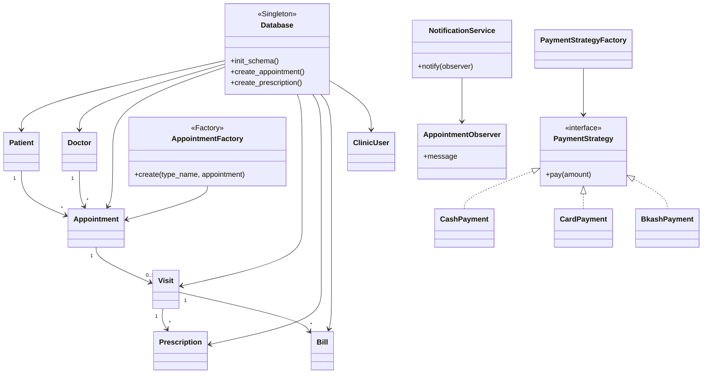

# Clinic Appointment System

A persistent Flask and SQLite clinic management application developed for **CSE 3206 Software Engineering Sessional (CO4)**, RUET.

The application provides patient management, doctor management, appointment scheduling, clinical visits, prescriptions, billing, authentication, notifications, and API documentation.

## Features

### Patients and doctors

- Register and list patients.
- Register doctors with specialty and schedule.
- Store clinic records persistently in SQLite.

### Appointments

- Schedule appointments with doctor/date/time conflict prevention.
- Reschedule appointments.
- Cancel appointments.
- Prevent double booking.

### Clinical visits and prescriptions

- Record a visit for an appointment.
- Store diagnosis, prescription, and visit notes.
- Create separate prescription records with medicine, dosage, duration, and instructions.

### Billing

- Create bills for visits.
- Mark bills as paid.
- Support Cash, Card, and bKash payment strategies.

### Accounts and security

- Sign up, log in, and log out.
- Hash passwords with Werkzeug.
- Store login state in a Flask session.
- Protect application pages and API routes.

### Quality and developer experience

- Responsive clinic dashboard with SVG icons.
- Clear API validation and error responses.
- Interactive Swagger/OpenAPI documentation.
- Automated pytest, mock, Selenium, coverage, and GitHub Actions checks.

## Technology stack

| Area | Technology |
|---|---|
| Backend | Python, Flask |
| Database | SQLite |
| Frontend | HTML, CSS, JavaScript |
| Testing | pytest, unittest.mock, Selenium, coverage |
| API documentation | Swagger UI, OpenAPI 3 |
| CI | GitHub Actions |
| Version control | Git, GitHub |

## Requirements

### Functional requirements

| ID | Requirement |
|---|---|
| FR-01 | A receptionist can add and list patients. |
| FR-02 | A receptionist can add doctors with specialty and schedule. |
| FR-03 | An appointment must not double-book a doctor at the same date and time. |
| FR-04 | A receptionist can cancel or reschedule an appointment. |
| FR-05 | A clinician can record diagnosis, prescription, and notes for a visit. |
| FR-06 | A clinician can issue a separate prescription record. |
| FR-07 | Billing staff can create a bill for a visit. |
| FR-08 | Billing staff can mark a bill paid using Cash, Card, or bKash. |
| FR-09 | A user can sign up, log in, and log out securely. |
| FR-10 | The system emits notification events for scheduling and payment actions. |
| FR-11 | The dashboard summarizes clinic entity counts. |

### Non-functional requirements

- Data persists across application restarts.
- Passwords are never stored as plain text.
- Protected routes require an authenticated session.
- Required API fields return clear HTTP validation errors.
- The interface works on desktop and mobile screens.
- Core services are separated from HTTP and persistence code.
- New payment methods and appointment types can be added without rewriting existing modules.

## Prototype

The working interface in `templates/index.html` serves as the implemented prototype. Its screens cover the dashboard, patients, doctors, appointments, visits, prescriptions, and billing.

## Process model

The project uses an **Incremental** process model.

1. Database and application foundation
2. Patient and doctor modules
3. Appointment scheduling
4. Visits, prescriptions, and billing
5. Authentication and professional interface
6. Tests, CI, and Swagger documentation

Incremental delivery was preferred over Waterfall because later modules depended on earlier patient, doctor, appointment, and visit workflows.

## Design patterns

| Pattern | Category | Implementation | Problem solved | Rejected alternative |
|---|---|---|---|---|
| Singleton | Creational | `Database` | One database configuration and lifecycle | Separate connections in every route |
| Factory Method | Creational | `AppointmentFactory` | Centralized appointment type construction | Route-specific `if/else` construction |
| Observer | Behavioral | `NotificationService`, `AppointmentObserver` | Decoupled scheduling and payment notifications | Direct notification calls inside database logic |
| Strategy | Behavioral | `PaymentStrategyFactory`, Cash/Card/bKash classes | Runtime selection of payment behavior | A large payment `if/else` block |
| Factory | Creational | `ClinicUserFactory` | Validation and construction of clinic role profiles | Direct role dictionaries in authentication code |

At least three patterns from at least two categories are implemented.

## UML class diagram



## Testing

Tests use pytest, `unittest.mock`, and Selenium.

```powershell
python -m pytest -m "not selenium"
python -m coverage run -m pytest -m "not selenium"
python -m coverage report -m
python -m pytest tests/test_selenium.py -v
```

Coverage, authentication, API, database, rescheduling, prescription, mock, and payment behavior are included in the test suite.

## GitHub Actions CI

The workflow in `.github/workflows/ci.yml` installs dependencies and runs the non-Selenium test suite with coverage on push and pull request events.

## Swagger/OpenAPI

Swagger is the selected self-directed tool.

- Interactive API UI: `http://127.0.0.1:5000/docs`
- OpenAPI specification: `http://127.0.0.1:5000/openapi.json`

The Swagger UI provides direct endpoint discovery and testing. README-only documentation was the rejected alternative because it is easier to become inconsistent with route implementation.

## Configuration management

- `main`: integration-ready code.
- `feature/<module>`: new modules.
- `fix/<issue>`: fixes.
- `docs/<topic>`: documentation.
- Commit messages use prefixes such as `feat:`, `fix:`, `test:`, `refactor:`, and `docs:`.

More Git and merge-conflict evidence should be recorded in `docs/GIT_AND_CI_EVIDENCE.md`.

## Run locally

```powershell
cd "C:\Users\ASUS\Downloads\Lab6\Lab6"
python -m pip install -r requirements.txt
python seed.py
python app.py
```

Open:

- Application: `http://127.0.0.1:5000`
- Login: `http://127.0.0.1:5000/login`
- API documentation: `http://127.0.0.1:5000/docs`

Seeded administrator account:

- Email: `admin@medicare.local`
- Password: `admin123`

These credentials are demonstration credentials only.

## Project structure

- `app.py`: Flask application and HTTP routes.
- `database.py`: SQLite schema and persistence.
- `patterns.py`: factory, observer, and strategy implementations.
- `templates/`: login and application HTML.
- `static/`: CSS and JavaScript.
- `tests/`: unit, API, mock, and Selenium tests.
- `docs/`: project report and Git evidence checklist.
- `.github/workflows/ci.yml`: GitHub Actions workflow.

## Extending the system

- Add a new payment method by creating a strategy class and registering it in `PaymentStrategyFactory`.
- Add an SMS or email channel by adding a notification observer.
- Add a new appointment or user role in the matching factory.
- Add a new clinic module with a table, routes, UI section, and tests.
